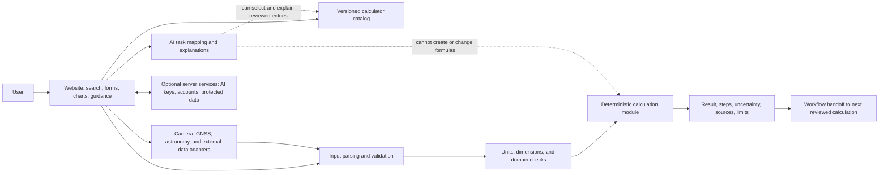

# Technical Implementation Blueprint

**Status:** Architecture guide for the AuraCalc static website and calculation platform. The Emergent-inspired public-site shell and four R0 definitions now exist; hosting, browser/device audits, service integrations, and broad domain coverage remain open.

## 1. What exists today

The [prototype](prototype/README.md) demonstrates task discovery, a guided workspace, scenario comparison, camera interaction, accessible explanations, and a result handoff. It intentionally has no reviewed calculator definitions. Its task helper uses local sample rules, and its camera measurement assumes a reference and a shared flat plane. Keep it as a product interaction reference; replace its sample behavior with production modules behind explicit interfaces.

## 2. Recommended starting technology

- **Website:** Next.js App Router, React, and TypeScript. This gives the project a typed web application structure and supports pre-rendered, crawlable field and calculator pages alongside interactive calculator screens. Next.js documents its Server and Client Component model and supports static output as well as server deployments; static output cannot provide runtime server features, so use a managed Node-capable deployment if the first release needs protected AI calls or dynamic server endpoints. [Next.js App Router](https://nextjs.org/docs/app), [Next.js rendering modes](https://nextjs.org/docs/app/guides/single-page-applications), [Next.js deployment options](https://nextjs.org/docs/15/app/getting-started/deploying).
- **Types and input schemas:** TypeScript for application contracts, plus runtime schema validation for untrusted form, URL, imported, or service data. Zod is one compatible option; TypeScript types alone do not validate runtime user input. [TypeScript documentation](https://www.typescriptlang.org/docs/), [Zod documentation](https://zod.dev/).
- **Calculation code:** deterministic TypeScript modules with no UI, network, clock, storage, or AI dependency. Use a math library only for operations it demonstrably supports; a library’s unit conversion or expression features do not verify a domain formula. Math.js, for example, documents unit values and custom units, which may be useful as a low-level aid after independent review. [Math.js unit documentation](https://mathjs.org/docs/datatypes/units.html).
- **Catalog:** begin with version-controlled definitions and references in the project. Add a database or content-management service only when editing, accounts, or data volume actually needs one. This keeps routine operations simple and lets each formula change be reviewed in the same history as its source and verification record.

These are starting recommendations, not a requirement to keep one vendor or library forever. Recheck supported versions and deployment details when scaffolding the application.

## 3. Application shape

Build one web application with clear internal modules before considering multiple services. Render informational field pages and calculator explanations for search engines. Run ordinary calculations in the browser where practical so inputs stay on the user’s device. Keep AI credentials, accounts, private saved work, protected data APIs, and heavy server-only computation behind server endpoints.



The browser UI presents fields, errors, results, explanations, and visuals. The catalog describes what a calculator needs and how it is documented. Shared calculation services handle units, numeric policies, validation, and provenance. Each field module supplies its own reviewed method. Adapters for camera or external data supply candidate inputs; they do not silently turn estimates into trusted measurements.

## 4. Calculator definition and execution contract

Every calculator should be an independently versioned catalog entry paired with a deterministic calculation function. The catalog entry should contain:

- stable ID, title, field/subfield, keywords, language, and version;
- intended task, user audience, permitted use, exclusions, jurisdiction or standard edition where relevant;
- input definitions: type, required/optional status, unit dimension, accepted units, limits, and validation messages;
- result definitions: output quantity and dimension, display units, interpretation, and warnings;
- equation or algorithm explanation, named references, assumptions, limitations, and effective/source dates;
- numerical method, precision/rounding policy, uncertainty model, and known edge cases;
- worked examples and independently prepared verification cases;
- risk classification, reviewer/approval state, change history, and next source-review date;
- visualization, accessibility, localization, privacy, and related-workflow metadata.

Conceptually, the engine contract is:

```text
raw user values
  → locale-aware parsing
  → schema and range validation
  → unit conversion to canonical quantities
  → dimension and domain checks
  → reviewed deterministic method
  → uncertainty and applicability checks
  → structured result with provenance
  → locale-aware display formatting
```

The output remains structured data, not just a formatted string. A result should carry its numeric value, unit/dimension, formula ID and version, source set, input values, conversions, assumptions, warnings, and calculation timestamp where time-sensitive data was used. A downstream workflow consumes the structured value and provenance, never a rounded display string.

## 5. Units, dimensions, and numerical integrity

- Store each physical quantity as a value plus an explicit unit and dimension. Reject incompatible operations, such as adding a length to a temperature.
- Convert inputs into a defined internal representation before calling the domain method. Keep input units and conversion steps so the result can be audited.
- Model offset and logarithmic units with explicit conversion rules. Temperature scales and decibels cannot safely be treated as simple scale factors in every operation.
- Keep locale parsing separate from numerical meaning. A comma may be a decimal mark or a grouping mark; show accepted entry formats and never silently guess an ambiguous value.
- Select numeric representation by problem class: ordinary floating-point methods for suitable continuous calculations; decimal or fixed-point arithmetic for currency and decimal accounting; integers or rational arithmetic when exact discrete results or exact conversions are required.
- Preserve internal precision through the calculation. Apply a documented rounding and significant-digit policy at defined output boundaries, not after every intermediate step.
- For iterative solvers and simulations, report convergence, tolerances, model limits, and failure states. Do not return a normal-looking number when the method did not converge.
- Represent uncertainty and measurement quality when the inputs or method warrant it. Avoid extra displayed digits that imply more certainty than the data supports.

## 6. Validation and failure behavior

Validation has separate layers: input shape and finite numeric values; unit/dimension compatibility; mathematical domain constraints; physical or field-specific ranges; and applicability of assumptions or standards. Errors should identify the input and explain what needs correction. Warnings should remain visible in exported results. Missing data, incompatible units, non-convergence, out-of-range inputs, stale reference data, and unsupported operating conditions must have explicit outcomes rather than hidden fallback values.

Risk classification determines review and result language. Higher-risk engineering, medical, safety, and financial tools need stronger references, independent calculation checks, and clear limits. A calculator can support a qualified professional but should not claim certification or replace a required professional judgment or applicable code.

## 7. Multi-step workflows

Model a workflow as a versioned directed graph of approved calculator definitions. Every step has typed inputs and outputs. A handoff is allowed only when dimensions, units, scope, jurisdiction, and assumptions are compatible. Preserve provenance at each edge, let the user inspect and edit carried values, and make branches/scenario comparisons explicit. A workflow combines reviewed calculations; it does not make an unreviewed formula acceptable.

## 8. Shared calculation history

History is a shared platform service exposed from every calculator page, with both a global list and a filter for the current calculator. A calculator records only a successful result and its associated input snapshot; incomplete or invalid forms do not become calculation-history entries.

```text
HistoryRecord {
  id, calculatorId, definitionVersion, savedAt,
  inputsWithUnits, originalStructuredResult,
  assumptions, warnings, sourceDataVersions, locale,
  sensitivity, provenance
}
```

- Keep history on the current device by default; do not require an account or upload values to a server. Let users pause history, skip an individual run, delete one entry, and clear all entries. Show when saving is active.
- Device-local browser storage is not a secure vault. Make the current-browser scope clear, and keep history off for sensitive tools unless the user explicitly opts in. Do not silently discard old entries when storage limits are reached; explain the limit and let the user delete entries.
- Save completed runs for ordinary tools when history is enabled. For medical, financial, or other sensitive tools, require a clear per-tool or per-run opt-in instead of silently retaining inputs.
- Keep the saved result immutable and identify the calculator/formula/data version that produced it. “View saved result” reopens the original answer and its provenance. “Restore inputs” fills the current form; if the active formula or data version differs, require a fresh calculation and label it as new. Never silently replace the historical result.
- Preserve units, locale, assumptions, warnings, and data timestamps with the inputs so restored values retain their meaning. Workflow history also preserves each step and typed handoff.
- Do not save camera frames, raw recordings, or private values in analytics, URLs, or public page metadata. For image-based calculations, keep derived values and calibration details only when the user’s history setting permits; explain that the original image will not be available for replay.
- Provide a visible history-saving preference, delete controls, and a clear local-storage failure state. A local history is device/browser-specific and does not synchronize across devices.

The prototype implements a local-only demonstration of this interface and storage pattern. It retains up to 100 entries and stops saving at the limit until the user deletes entries; it does not silently evict older records. Production calculators must call the same shared history service from the common calculation-result path rather than building separate history code in each calculator.

## 9. AI, camera, and data services

- **AI guide:** retrieve matching definitions and explain their reviewed content. It may help map a user’s language to a tool, parse candidate values, and explain what information is missing. The user confirms parsed inputs. The engine—not the AI—executes the method. Keep secrets server-side and disclose any data sent to an AI service.
- **Camera and sensors:** create separate input adapters for image/video, device motion, GNSS, depth, and astronomy orientation. Show calibration source, sensor capability, confidence/uncertainty, and limitations. Permit manual correction. The calculation engine receives a measured value with its quality metadata, not an unqualified claim that the camera “knows” a dimension or speed.
- **External reference data:** attach provider, location/coverage, observation or publication time, units, license, and freshness state to each dataset. Fail visibly when required data is stale or unavailable.
- **Privacy:** ordinary calculations should work without an account where possible. Keep input values and camera frames local by default; send only the minimum necessary data to an explicitly enabled service.

## 10. Accessibility, localization, and public pages

Use semantic form labels, keyboard support, screen-reader announcements for updated results and errors, and text equivalents for charts, motion, and video. Keep chart information understandable without color alone. Separate translated interface content from formula meaning and source records. Parse numbers by an explicit user-selected or clearly detected locale, but never infer a physical unit from locale. Keep URLs stable and create useful pre-rendered field and calculator pages with scope, variables, method overview, sources, and limitations. Never place a user’s entered values in a public URL or search metadata.

## 11. Verification and release gates

Before a definition is public, its record needs a source-backed specification and a named review. Verification should include independently computed reference cases, dimensional/unit checks, boundary and invalid-input cases, edge cases, and regression checks when a formula or dependency changes. Where appropriate, check invariants or compare against a trusted external standard implementation. Record evidence and reviewer sign-off with the definition version. Higher-risk calculations require an independent technical review before publication. The platform can automate routine checks, but passing automated checks alone is not proof of engineering validity.

Release status should be explicit, for example: `discovered → specified → reviewed → verified → published`, with `stale`, `paused`, and `retired` side states. Only `verified` entries can be loaded into the public catalog. Source or method changes create a new version and trigger review of dependent workflows.

## 12. Build sequence for the complete V1 scope

The sequence below organizes the work; it does not reduce the previously agreed V1 feature set.

1. **Production foundation:** create the Next.js/TypeScript application, shared navigation, page templates, catalog routes, design system, and accessibility conventions. Rebuild the prototype interactions as real app components.
2. **Trusted calculator core:** implement catalog schemas, runtime input validation, quantity/unit and precision services, structured results, provenance, error states, and release gates. Then add individually researched and approved definitions.
3. **Catalog, workflows, and history:** add field discovery/search, workflow graph execution, editable typed handoffs, local history and restore behavior, scenarios, and traceable export.
4. **Global website:** add localized routes/content, accessible visualization and demonstrations, useful SEO pages, consent-aware analytics, and help/issue reporting.
5. **Advanced inputs and guidance:** integrate reviewed AI retrieval/input mapping, camera/sensor adapters, astronomy data, image-based methods, and their calibration, quality, consent, and failure handling.
6. **Launch and operations:** deploy through a managed host; configure domain/HTTPS, monitoring, backups, rollback, privacy disclosures, security updates, and the monthly source/dependency review routine.

The catalog can be designed to support the rough eventual estimate of about 2,000 definitions, but that estimate is not an audited count. The platform does not need 2,000 custom page implementations: it needs reusable rendering and calculation contracts plus individually researched, reviewed, versioned entries.

## 13. First production decision and current implementation

The calculation core now lives in `src/calculation-core/`, and the first runnable website lives in `web/`. The site is a dependency-free ES-module application with a Node local server, a static build, generated SEO pages for each published calculator, browser-local history, JSON exports, local feedback capture, a 48-group research map, and a consent-gated advertising adapter. A static deployment bundle is produced in `dist/` by `npm run build`.

The public catalog currently contains four R0 starter definitions: percentage change, rectangle area/perimeter, rectangular-prism volume, and average speed. Their release records identify developer self-review and executable reference cases; no independent domain reviewer is recorded. A unit-conversion utility uses the curated versioned registry. The area-to-volume handoff has a typed, source-versioned workflow record. These additions make the site useful for simple tasks while preserving a release gate for other definitions. The existing `prototype/` remains a separate interaction demonstration; its sample camera and assistant behavior are not production services.

The initial static architecture was selected to keep routine operation simple and avoid paid or network-installed dependencies. Move to a typed framework or server-backed services when the product actually needs protected AI calls, accounts, synchronized data, current data feeds, or server-side computation. `deployment-and-maintenance.md` describes the current static build and monthly maintenance steps. The next steps are browser/device and accessibility audits, a hosting choice, privacy/consent work before ads or external services, and individually researched calculator families. Keep high-consequence tools out of the published catalog until their source applicability, expected values, risk review, and qualified sign-off are complete.
